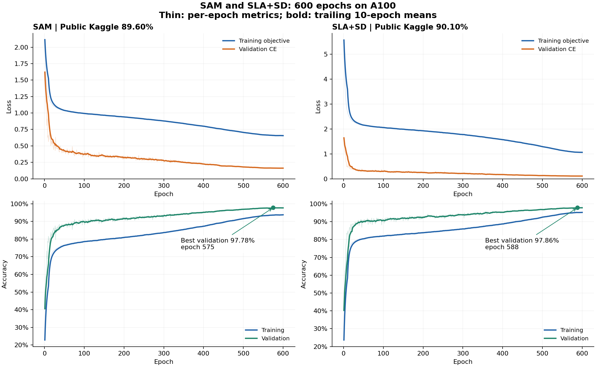
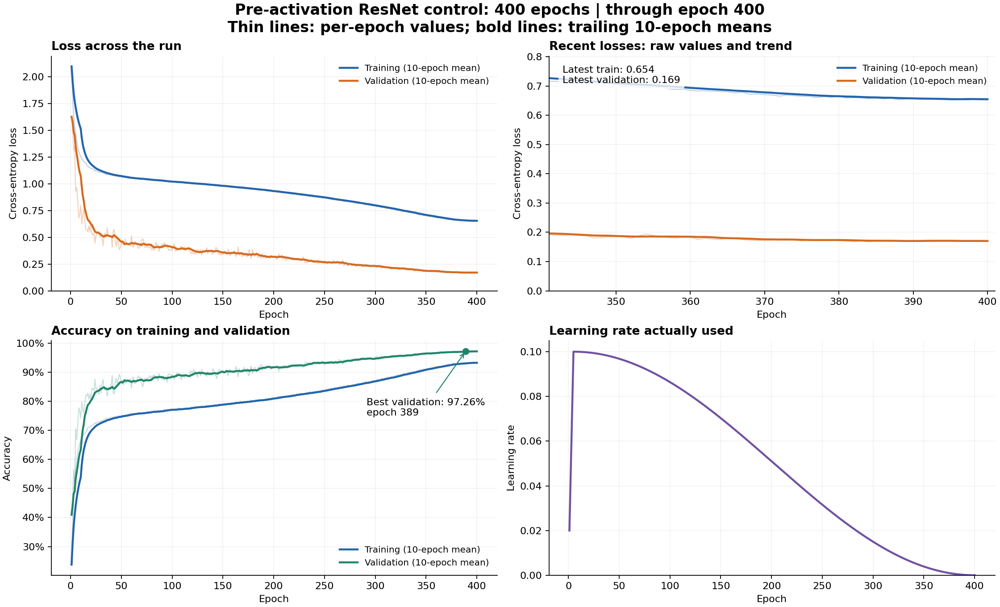

# CIFAR-10 ResNet Architecture Challenge

Configurable PyTorch experiments for CIFAR-10 classification under a **5-million-trainable-parameter limit**. The project supports residual CNN architecture comparisons, SGD and AdamW, resumable experiment plans, and staged training on Apple MPS or NVIDIA CUDA.

## Results

**Best completed validation accuracy: 97.86%. Best reported public Kaggle accuracy: 90.10%.**

<!-- RESULTS:START -->
| Architecture | Optimizer | Parameters | Epochs completed | Best epoch | Training loss | Validation loss | Validation accuracy |
|---|---|---:|---:|---:|---:|---:|---:|
| Baseline | SGD | 1,084,586 | 200/200 | 194 | 0.0032 | 0.1824 | 95.26% |
| Baseline | AdamW | 1,084,586 | 200/200 | 199 | 0.0005 | 0.4123 | 93.24% |
| Deeper | SGD | 1,860,522 | 200/200 | 199 | 0.0019 | 0.1826 | 95.38% |
| Deeper | AdamW | 1,860,522 | 200/200 | 191 | 0.0005 | 0.4550 | 93.56% |
| Wider | SGD | 2,436,346 | 200/200 | 200 | 0.0022 | 0.1574 | 95.64% |
| Wider | AdamW | 2,436,346 | 200/200 | 198 | 0.0002 | 0.3893 | 94.10% |
| Deeper + wider | SGD | 4,180,858 | 200/200 | 195 | 0.0016 | 0.1761 | 95.82% |
| Deeper + wider | AdamW | 4,180,858 | 143/200 | 136 | 0.0027 | 0.3771 | 94.34% |
| Attention ResNet control | SGD | 4,534,066 | 300/300 | 300 | 0.4666 | 0.1324 | 97.14% |
| Pre-activation control | SGD | 4,696,394 | 400/400 | 389 | 0.6549 | 0.1689 | 97.26% |
| Attention ResNet, A100 | SGD | 4,534,066 | 600/600 | 583 | 0.4427 | 0.1267 | 97.10% |
| Pre-activation A100 control | SGD | 4,696,394 | 600/600 | 575 | — | 0.1725 | 97.38% |
| Pre-activation A100 + SAM | SGD + SAM | 4,696,394 | 600/600 | 575 | 0.6565 | 0.1617 | 97.78% |
| Pre-activation A100 + SLA+SD | SGD | 4,706,674 | 600/600 | 588 | 1.0618 | **0.1096** | **97.86%** |
| Pre-activation control, full 50k | SGD | 4,696,394 | 600/600 | — | 0.6408 | N/A | N/A |

Losses and accuracy are reported at each run's highest-validation-accuracy epoch. Fourteen runs are reported complete; the larger AdamW trial has 143/200 epochs saved and remains incomplete. Validation runs are configured with the same stratified 45,000/5,000 split. SAM and SLA+SD results are verified against downloaded checkpoints, configs, metric histories, and submission CSV hashes. The A100 SGD-control row is from a user-pasted summary; its training loss and full export remain pending. Training loss uses augmented images and the configured label smoothing; validation loss is ordinary cross-entropy on unaugmented images. The full-50k row uses final-epoch training loss verified from its imported summary and has no validation split. SLA training loss sums ordinary classification, joint class/rotation classification, and distillation losses; its total is not directly comparable with SAM or ordinary classification loss.
<!-- RESULTS:END -->

| Public Kaggle submission | Accuracy |
|---|---:|
| Initial baseline submission during training | 79.50% |
| Completed baseline submission | 84.00% |
| Deeper + wider SGD submission | 85.30% |
| Attention ResNet control, intermediate epoch 156 | 81.10% |
| Attention ResNet control, completed epoch 300 | 87.80% |
| Pre-activation control, best epoch 389 of 400 | 88.80% |
| Attention600, best epoch 583, mirror/translation TTA | 88.80% |
| SAM600, best epoch 575, mirror/translation TTA | 89.60% |
| SLA+SD600, best epoch 588, mirror/translation TTA and joint-head vote | **90.10%** |
| Plain control600, full 50k, final checkpoint with TTA | 88.70% |

Public scores are reported from leaderboard screenshots. Hidden evaluation labels are unavailable; evaluation loss and private accuracy cannot be calculated. Details: [submission history](docs/leaderboard.md).

The full-50k plain control scored **88.70%** publicly, versus 88.80% for the earlier 400-epoch plain control and 90.10% for SLA+SD600. This is no measured improvement; epoch budget, data split and execution platform differ from the earlier plain run, so the small decline cannot be attributed solely to data size. Its CSV, inference metadata, final summary, and reconstructed 50k/zero-validation split fingerprint are verified locally. This export contains no checkpoint weights or per-epoch history. No full-data SLA or SAM result is implied.

The A100 comparison shows **SAM at 97.78% validation accuracy**, up 0.40 percentage points from its matched float32 SGD control (97.38%). **SLA+SD600 reaches 97.86% accuracy and 0.1096 loss**, the strongest verified validation result so far. Its accuracy advantage over SAM is only four validation images; SLA uses CUDA AMP while SAM/control use float32. Their reported public scores are **89.60% for SAM** and **90.10% for SLA+SD**, making SLA+SD the current public best. [HPC result records](docs/a100_reported_results.json).

The completed A100 attention600 run reached **97.10% best validation accuracy** (epoch 583), with **0.1267 validation loss**, and **88.80% reported public accuracy**. It ties the 400-epoch plain control on the public leaderboard. Its lower validation loss does not translate into a higher public score, and its validation accuracy does not exceed the 300-epoch attention baseline. The 300-epoch and 600-epoch submissions also differ in TTA and training platform/precision, so this is not an isolated epoch-budget comparison. Further epoch increases are not supported by these results. [600-epoch curves](docs/figures/attention600/learning_curves.png) ([PDF](docs/figures/attention600/learning_curves.pdf)). Published plots and metric snapshots are in `docs/figures/attention600/`; the imported raw run is under `runs_hpc/attention600/`, and its submission CSV is in `submissions/`. Raw runs and submission files remain Git-ignored.

The completed pre-activation control achieved **97.26% validation accuracy** and **88.80% reported public accuracy**, improving on the attention model by 0.12 and 1.00 percentage points respectively. Its best checkpoint is epoch 389 of 400. This submission uses the configured mirror/translation augmentation, whereas the attention submission used standard inference, so the public-score difference includes changes in inference as well as training.

The completed attention control achieved **97.14% validation accuracy**, improving on the previous 95.82% best by **1.32 percentage points**, with validation loss falling from 0.1761 to **0.1324**. Its checkpoint is `runs_attention/attention_resnet_sweep000_20261031T025638Z_303819/best.pt`. This result is from the ten-class attention model without an auxiliary rotation task or inference augmentation; its reported public score is **87.80%**, improving on 85.30% by **2.50 percentage points**. Matched completed SGD recipes also outperform their AdamW counterparts. These are single-seed validation results; see the earlier [model comparison](docs/model_comparison.md).


### SAM and SLA+SD learning curves



Thin lines show per-epoch metrics; bold lines show trailing 10-epoch means. The marked checkpoints are **SAM epoch 575** (97.78% validation, 89.60% public) and **SLA+SD epoch 588** (97.86% validation, 90.10% public). Validation loss is ordinary cross-entropy for both models; SLA training loss includes its joint-label and distillation objectives. Public scores are separate submission results, not measurements from the curves.

Individual plots and snapshots: [SAM](docs/figures/sam600/learning_curves.png) ([PDF](docs/figures/sam600/learning_curves.pdf), [metrics](docs/figures/sam600/metrics_snapshot.csv)); [SLA+SD](docs/figures/sla600/learning_curves.png) ([PDF](docs/figures/sla600/learning_curves.pdf), [metrics](docs/figures/sla600/metrics_snapshot.csv)). Rebuild the comparison with `python scripts/plot_sam_sla.py` after installing the plotting requirements.

The imported checkpoints, configs, summaries and raw metrics are stored under Git-ignored `runs_hpc/a100_experiments/`. Prediction CSVs and their metadata are under Git-ignored `submissions/`; published curves and metric snapshots are tracked under `docs/figures/`.

### Pre-activation control learning curves



Thin lines show per-epoch metrics; bold lines show trailing 10-epoch means. Best validation accuracy is **97.26% at epoch 389**, with training loss **0.6549** and validation loss **0.1689**. Training uses augmentation and label smoothing; validation uses unaugmented images and ordinary cross-entropy. The **88.80% public score** is a separate submission result, not a curve measured during training. [Metric snapshot](docs/figures/preact_control_sweep000_20261031T071758Z_ed2534/metrics_snapshot.csv).

## Setup

For **Python 3.12 on Apple Silicon**:

```bash
bash scripts/setup_env.sh
source .venv/bin/activate
python scripts/check_env.py --require-mps
```

[requirements.txt](requirements.txt) pins the Mac environment. For NYU HPC, use a site-compatible Linux CUDA PyTorch environment and install the project with `python -m pip install -e .`; do not copy the Mac virtual environment. See the [HPC setup guide](docs/nyu_hpc.md). Optional dependencies are in `requirements-plot.txt` and `requirements-download.txt`.

## Dataset

Place the extracted competition files in `dataset/`, or override `data.root`:

```text
dataset/
├── train_labels.csv       # id,filename,label
├── test.csv               # id,filename
├── sample_submission.csv  # id,label
├── train_images/
└── test_images/
```

The default split uses **45,000 training and 5,000 validation images**, with split seed `42`. The evaluation set contains **2,000 unlabeled images**. Models train from scratch using only permitted training data.

```bash
python -m cifar10 check-data --config configs/base.yaml
```

## Current experiment plan: Pre-activation ResNet + SLA

The plain pre-activation control has completed 400 epochs, with **97.26% validation accuracy** and **88.80% reported public accuracy**. The separate HPC SLA+SD600 trial is reported complete at 97.86% validation accuracy and 0.1096 validation loss; its reported public score is **90.10%**.

| Trial | Blocks | Channels | Trainable parameters | Epochs |
|---|---|---|---:|---:|
| Pre-activation control | `[4,4,3]` | `[64,128,256]` | 4,696,394 | 400 |
| Pre-activation SLA+SD | `[4,4,3]` | `[64,128,256]` | 4,706,674 | 400 |

Both use 400 epochs, batch size 128, Nesterov SGD, five warmup epochs, cosine decay per optimizer step, TrivialAugmentWide, crop/flip, 12-pixel Cutout, and label smoothing 0.1. Weight decay excludes bias and normalization parameters. SLA learns 40 joint class/rotation labels and distills their aggregated predictions into a ten-class head. Its four rotated views increase computation per batch. Prediction supports mirror/translation augmentation and combined head probabilities.

```bash
source .venv/bin/activate
python -m cifar10 plan --config configs/sla/plan.yaml --dry-run
caffeinate -i python -m cifar10 plan --config configs/sla/plan.yaml \
  --readme runs_sla/report.md
```

The two models run sequentially on MPS and save checkpoints and measured losses under `runs_sla/`. Rerun the same command to resume from the last completed epoch. Stop any other local training process before starting. Existing attention checkpoints remain usable with their original architecture but cannot resume this new recipe.

Use `configs/sla/continue_current.yaml` to resume and finish the existing attention control before these two trials; stop the old process with Ctrl+C before switching plans. Use `configs/sla/only_sla.yaml` to run only SLA+SD. After validation selects the recipe, final training can use all 50,000 permitted images. No 90% hidden-set accuracy is claimed. See [objective, inference, and research references](docs/sla.md). Previous [attention experiments](docs/attention_resnet.md) and the [ten-experiment local queue](docs/local300_plan.md) remain available.


## Attention model: prediction augmentation and 600-epoch trial

Generate a separate submission from the completed 300-epoch attention checkpoint with mirror and reflected one-pixel translation augmentation:

```bash
python -m cifar10 predict \
  --checkpoint runs_attention/attention_resnet_sweep000_20261031T025638Z_303819/best.pt \
  --device mps --tta --translation-tta \
  --output submissions/submission_attention300_tta.csv
```

This keeps the trained weights fixed, allowing comparison with the existing 87.80% standard-inference submission. Its augmented public score has not been reported; the separate 600-epoch TTA submission scored 88.80%. Prediction also saves a `.metadata.json` sidecar containing the checkpoint epoch, inference flags, and CSV hash.

A separate **600-epoch attention trial** uses the same 4,534,066-parameter model, augmentation, optimizer, split, label smoothing, and epoch-based cosine schedule as the completed attention control. The schedule spans 600 epochs; training starts from scratch. Mirror/translation augmentation is enabled for prediction, while checkpoint selection still uses ordinary unaugmented validation accuracy. The 600-epoch trial has completed: best validation accuracy 97.10%, validation loss 0.1267, and reported public accuracy 88.80%.

```bash
caffeinate -i python -m cifar10 plan \
  --config configs/attention/600_plan.yaml \
  --readme runs_attention600/report.md
```

Run this after the current training queue finishes. To resume the SLA comparison and then run attention600 automatically, stop the old queue with Ctrl+C and use `configs/attention/after_sla600.yaml` instead. It skips completed trials and resumes matching saved checkpoints. Only an unfinished epoch repeats. The new attention trial writes to `runs_attention600/`.


## A100 experiment queue

A resumable queue continues after the existing attention600 run, then tests **eight more 600-epoch trials**: a matched float32 SGD control and SAM (rho 0.05), CUDA SLA+SD600, a full-50k control, channel attention, mixup, RandAugment, and a second training seed. Every model stays below 5 million parameters. The queue can span multiple allocations; it does not assume all nine runs will fit within 20 hours. The ongoing local SLA400 run is unchanged.

```bash
nohup python -u scripts/queue_a100.py --project "$PWD" \
  > runs_hpc/a100_queue.log 2>&1 &
```

On HPC, first upload/extract the small code update and activate the existing environment as described in the [A100 queue guide](docs/a100_queue.md). The launcher waits for the current attention run without stopping it, resumes saved trials, and skips completed matching trials. New results go to `runs_hpc/a100_experiments/`. SAM and its control use float32; SLA uses CUDA AMP. The initial attention600 result is recorded above. SAM and SLA exports are imported and verified; the matched SGD-control export remains pending. Reported public scores are 89.60% for SAM and 90.10% for SLA+SD.


## Next experiment: 800 epochs with validation

The active follow-up decision is **SLA+SD800 followed by SAM800**, trained from scratch on **49,000 labeled training images with a fixed stratified 1,000-image validation set** (`val_fraction=0.02`, split seed 42). Architecture, optimizer, augmentation, batch size, and precision remain those of the measured methods. Cosine decay spans all 800 epochs; validation selects `best.pt`. The 1k split provides monitoring but less precise accuracy estimates than the earlier 5k split, so scores from the two splits are not directly comparable.

`scripts/run_800_val1k.py` creates the resolved configs under Git-ignored `configs/generated/a100_800_val1k/`, waits for already-running queues, and then runs both methods sequentially. Outputs go to `runs_hpc/a100_800_val1k/`. On HPC, after the script has been copied/created there and the existing environment is active:

```bash
nohup python -u scripts/run_800_val1k.py \
  > runs_hpc/800_val1k_queue.log 2>&1 &
```

Run only one waiting launcher for this plan. It does not preempt earlier queues, and activation on HPC must be verified from its log; changing this local repository does not start it remotely. There are no measured results for these 800-epoch validation runs yet.

The earlier [full-data finalist plan](docs/a100_finalists.md) remains available as a separate alternative. It uses all 50,000 images, has no validation, and should not be launched alongside the new validation plan. Second-seed repeats remain at 600 epochs. Existing completed checkpoints are retained.

## Configuration and checkpoints

Architecture, optimizer, augmentation, and scheduling settings are defined in [configs/base.yaml](configs/base.yaml) and inherited by experiment presets. Override them without editing code:

```bash
python -m cifar10 train --config configs/adamw.yaml \
  --set 'model.blocks=[5,5,5]' optimizer.lr=0.0003
```

The original four-architecture SGD/AdamW comparison remains available through `python -m cifar10 plan --config configs/all_experiments.yaml`. All configurations are checked against the parameter limit before training.

Each run saves its config, split, environment, per-epoch metrics, summary, and checkpoints:

- **best.pt:** highest validation-accuracy checkpoint.
- **last.pt:** latest saved epoch, including optimizer and random-number states.

The `plan` command automatically resumes matching interrupted experiments and skips completed ones. Use **Ctrl+C** to stop a terminal training process, then rerun the same command; work after the last saved checkpoint is repeated. Keep config and path settings consistent. The standalone `train` command requires explicit resume:

```bash
python -m cifar10 train --config runs/RUN/config.yaml --resume runs/RUN/last.pt
```

Final full-data training has no validation split and produces `last.pt` without `best.pt`.

## Reporting and verification

```bash
python -m cifar10 report --runs runs --readme README.md
python -m unittest discover -s tests -v
```

**30 tests passed at the latest code verification**, covering data loading, parameter limits, checkpoint resume, submission formatting, HPC launcher arguments, stage generation, attention models, RAM caching, SLA joint-label alignment, detached self-distillation targets, head gradients, prediction augmentation, checkpoint inference, SAM analytical updates, BatchNorm handling, exact SAM resume, and queue locking. SAM and SLA600 CUDA results are verified from imported checkpoints, configs, summaries, and 600-epoch histories; public scores come from user-provided screenshots. CSV IDs, labels, order, and hashes have been verified.

To generate learning curves:

```bash
python -m pip install -r requirements-plot.txt
python scripts/plot_training.py --run runs/RUN
```
