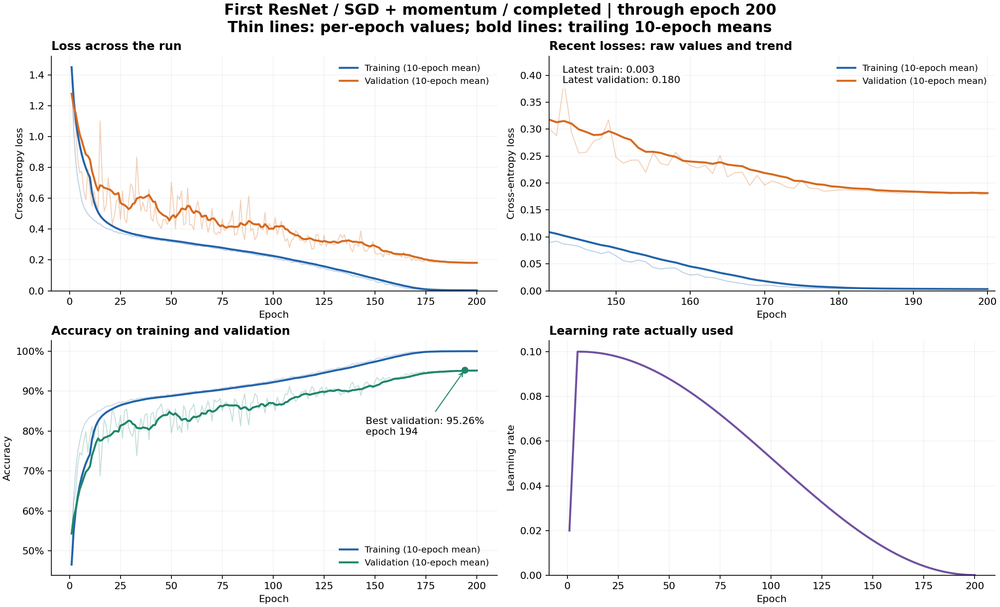

# CIFAR-10 ResNet Architecture Challenge

Configurable PyTorch experiments for CIFAR-10 classification under a **5-million-trainable-parameter limit**. Models train from scratch on the permitted competition data, with reproducible validation splits, checkpointing, and Kaggle submission generation.

## Results

**Best completed validation accuracy: 95.26%. Best reported public Kaggle accuracy: 84.00%.**

<!-- RESULTS:START -->
| Model | Optimizer | Parameters | Epochs completed | Best epoch | Training loss | Validation loss | Validation accuracy |
|---|---|---:|---:|---:|---:|---:|---:|
| Baseline ResNet | SGD + momentum | 1,084,586 | 200 / 200 | 194 | 0.0032 | 0.1824 | **95.26%** |
| Baseline ResNet | AdamW | 1,084,586 | 12 / 200 | 12 | 0.3890 | 0.4320 | 85.28% |

Losses and accuracy are measured at each run's best validation-accuracy epoch. AdamW is an **in-progress snapshot at epoch 12**, not a completed comparison. Training loss uses augmented images; validation loss is cross-entropy on unaugmented validation images.
<!-- RESULTS:END -->

| Public Kaggle submission | Accuracy |
|---|---:|
| Initial baseline submission during training | 79.50% |
| Submission reported after baseline training completed | **84.00%** |

Public scores are user-reported and supported by leaderboard screenshots. Hidden evaluation labels are unavailable, so evaluation loss and private accuracy cannot be calculated. See [submission history](docs/leaderboard.md).



The completed baseline reached its best accuracy at epoch 194. Its lowest validation loss was **0.1788** at epoch 199. Validation performance stabilized near the end of the 200-epoch schedule.

## Setup

The pinned environment targets **Python 3.12 on Apple Silicon**.

```bash
bash scripts/setup_env.sh
source .venv/bin/activate
python scripts/check_env.py --require-mps
```

Dependencies are pinned in [requirements.txt](requirements.txt). The experiment plan uses Apple MPS; set `training.device=cuda` or `training.device=cpu` for other hardware. Optional plotting and Kaggle download dependencies are in `requirements-plot.txt` and `requirements-download.txt`.

## Dataset

Place the extracted competition files in `dataset/`, or set `data.root` in the configuration:

```text
dataset/
├── train_labels.csv       # id,filename,label
├── test.csv               # id,filename
├── sample_submission.csv  # id,label
├── train_images/
└── test_images/
```

The default stratified split uses **45,000 training and 5,000 validation images**, with split seed `42`. The evaluation set contains **2,000 unlabeled images**. Only permitted training images are used for training; pretrained weights and external training datasets are excluded.

```bash
python -m cifar10 check-data --config configs/base.yaml
```

## Training

Run the complete architecture and optimizer comparison:

```bash
# Preview checkpoint reuse and experiment order.
python -m cifar10 plan --config configs/all_experiments.yaml --dry-run

# Run, or resume after interruption.
python -m cifar10 plan --config configs/all_experiments.yaml
```

The plan runs **SGD followed by AdamW for each architecture**, sequentially, with a **200-epoch budget per experiment**. Completed experiments are skipped; interrupted experiments resume from the latest matching checkpoint. Press **Ctrl+C** to stop and rerun the same command to continue. Work after the last saved epoch is repeated. Run one training command at a time.

| Architecture | Blocks per stage | Channels per stage | Trainable parameters |
|---|---|---|---:|
| Baseline | `[3, 3, 3]` | `[32, 64, 128]` | 1,084,586 |
| Deeper | `[5, 5, 5]` | `[32, 64, 128]` | 1,860,522 |
| Wider | `[3, 3, 3]` | `[48, 96, 192]` | 2,436,346 |
| Deeper + wider | `[5, 5, 5]` | `[48, 96, 192]` | 4,180,858 |

Each model uses two-convolution residual blocks, projection shortcuts when dimensions change, global average pooling, and a 10-class classifier. Configurations exceeding the parameter budget are rejected before training.

| Optimizer | Initial learning rate | Weight decay | Schedule |
|---|---:|---:|---|
| SGD, momentum 0.9, Nesterov | 0.1 | 0.0005 | 5-epoch warmup, cosine decay to 0.0001 |
| AdamW | 0.001 | 0.01 | 5-epoch warmup, cosine decay to 0.000001 |

Both use batch size `128`, random crops, and horizontal flips. Architecture, optimizer, augmentation, and scheduling settings are defined in [configs/base.yaml](configs/base.yaml) and inherited by experiment presets. Override settings without editing code:

```bash
python -m cifar10 train --config configs/adamw.yaml \
  --set 'model.blocks=[5,5,5]' optimizer.lr=0.0003
```

Each run stores its resolved configuration, split, environment, and per-epoch metrics under `runs/`. **`best.pt`** selects the highest validation accuracy; **`last.pt`** saves the latest completed epoch, including optimizer and random-number states. The `train` command requires explicit resume; automatic resume is provided by `plan`.

```bash
python -m cifar10 train --config runs/RUN/config.yaml --resume runs/RUN/last.pt
```

## Reporting and tests

```bash
# Refresh the results table from saved runs.
python -m cifar10 report --runs runs --readme README.md

# Run pipeline and checkpoint-resume tests.
python -m unittest discover -s tests -v
```

To generate learning curves:

```bash
python -m pip install -r requirements-plot.txt
python scripts/plot_training.py --run runs/RUN
```
