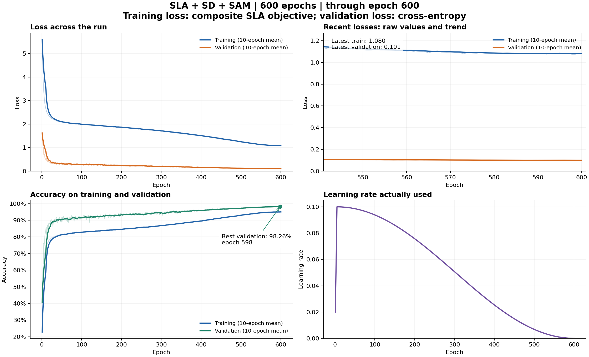
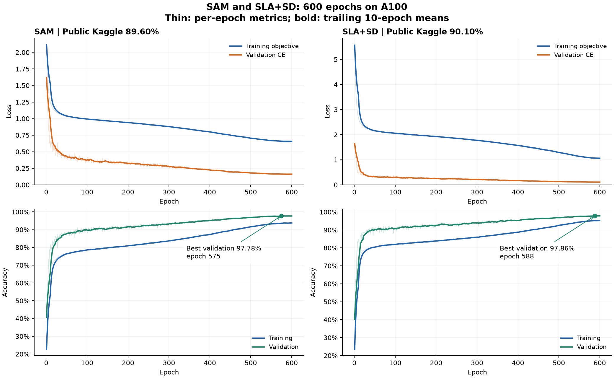

# CIFAR-10 ResNet Architecture Challenge

Configurable PyTorch experiments for CIFAR-10 classification under a **5-million-trainable-parameter limit**. The project supports residual CNN architecture comparisons, SGD and AdamW, resumable experiment plans, and staged training on Apple MPS or NVIDIA CUDA.

## Results

Run-summary JSON files are collected in [docs/run_summaries/](docs/run_summaries/). See the [run-summary directory](#run-summary-json-files) below for individual records, the [JSON index](docs/run_summaries/index.json), and [public submission scores](docs/run_summaries/public_submissions.json).

The revised report and [final-model summary](docs/run_summaries/final_sla_sam600.json) list **97.20% public accuracy, 98.92% validation accuracy, and 0.0862 validation cross-entropy** at epoch **588** of a 600-epoch schedule, with **4,956,062 parameters**. Architecture details and the current configuration are described below, followed by the earlier experiments and their checkpoint evaluations.

**Earlier SLA+SD+SAM600 model**, with **4,706,674 parameters**: **98.26% validation accuracy** and **0.09865 validation loss** at epoch **598**, reproduced locally on the original 5k split. Its submission record reports **91.20% public accuracy** for `submission_sla_sam600_tta.csv`, improving the preceding public best by **1.10 percentage points**. Its selected epoch, full history, parameter count, split and submission hash have been checked locally. [Submission record](docs/run_summaries/submissions/sla_sam600_submission.json).

**Earlier model's follow-ups:** SLA+SD+SAM with RandAugment scored **90.60%**; continuing the original winning checkpoint to epoch 700 retained epoch **598** as the best. Neither displaced that model's **91.20%** submission.

### Final architecture and current configuration

The final architecture uses 11 pre-activation residual blocks, arranged as **[4,4,3]**, with stage widths **[64,128,266]**. Global average pooling feeds a ten-class classifier, a 40-output joint class/rotation head, and a four-output rotation head. The complete architecture contains **4,956,062 trainable parameters**, below the five-million limit.

| Revised-report entry | Epochs / selected epoch | Parameters | Training objective | Validation CE | Validation accuracy | Public accuracy |
|---|---:|---:|---:|---:|---:|---:|
| Final SLA+SD+SAM | 600 / 588 | 4,956,062 | 0.935838 | 0.0862 | 98.92% | 97.20% |

[final_model.py](final_model.py) builds this architecture. Its [configuration](configs/final_model.yaml) uses the training CLI's native schema: batch size 128, seed 42, float32, Nesterov SGD, SAM radius 0.05, five warmup epochs, and cosine decay. The current executable objective combines ordinary classification, joint-label classification, and self-distillation. The separate rotation head is available, with its auxiliary loss weight set to zero.

```bash
python final_model.py
python final_model.py --show-config
```

Use these commands to inspect the architecture and configuration. Model weights are excluded from Git by [.gitignore](.gitignore).

### Earlier experiment results

<!-- RESULTS:START -->
| Architecture | Optimizer | Parameters | Epochs completed | Best epoch | Training loss | Validation loss | Validation accuracy |
|---|---|---:|---:|---:|---:|---:|---:|
| Baseline | SGD | 1,084,586 | 200/200 | 194 | 0.0032 | 0.1824 | 95.26% |
| Baseline | AdamW | 1,084,586 | 200/200 | 199 | 0.0005 | 0.4123 | 93.24% |
| Deeper | SGD | 1,860,522 | 200/200 | 199 | 0.0019 | 0.1826 | 95.38% |
| Deeper | AdamW | 1,860,522 | 200/200 | 191 | 0.0005 | 0.4550 | 93.56% |
| Wider | SGD | 2,436,346 | 200/200 | 200 | 0.0022 | 0.1574 | 95.64% |
| Wider | AdamW | 2,436,346 | 200/200 | 198 | 0.0002 | 0.3893 | 94.10% |
| Deeper + wider | SGD | 4,180,858 | 200/200 | 195 | 0.0016 | 0.1761 | 95.82% |
| Deeper + wider | AdamW | 4,180,858 | 143/200 | 136 | 0.0027 | 0.3771 | 94.34% |
| Attention ResNet control | SGD | 4,534,066 | 300/300 | 300 | 0.4666 | 0.1324 | 97.14% |
| Pre-activation control | SGD | 4,696,394 | 400/400 | 389 | 0.6549 | 0.1689 | 97.26% |
| Attention ResNet, A100 | SGD | 4,534,066 | 600/600 | 583 | 0.4427 | 0.1267 | 97.10% |
| Pre-activation A100 control | SGD | 4,696,394 | 600/600 | 575 | — | 0.1725 | 97.38% |
| Pre-activation A100 + SAM | SGD + SAM | 4,696,394 | 600/600 | 575 | 0.6565 | 0.1617 | 97.78% |
| Pre-activation A100 + SLA+SD | SGD | 4,706,674 | 600/600 | 588 | 1.0618 | 0.1096 | 97.86% |
| Pre-activation A100 + SLA+SD+SAM | SGD + SAM | 4,706,674 | 600/600 | 598 | 1.0710 | **0.0986** | **98.26%** |
| Pre-activation control, full 50k | SGD | 4,696,394 | 600/600 | — | 0.6408 | N/A | N/A |

Losses and accuracy correspond to each run's highest-validation-accuracy epoch. The larger AdamW trial remains incomplete at 143/200 epochs. Validation runs are configured with the same stratified 45,000/5,000 split. SAM and SLA+SD results are verified against downloaded checkpoints, configs, metric histories, and submission CSV hashes. The A100 SGD-control row is from a user-pasted summary; its training loss and full export remain pending. Training loss uses augmented images and the configured label smoothing; validation loss is ordinary cross-entropy on unaugmented images. The full-50k row uses final-epoch training loss verified from its imported summary and has no validation split. SLA training loss sums ordinary classification, joint class/rotation classification, and distillation losses; its total is not directly comparable with SAM or ordinary classification loss.
<!-- RESULTS:END -->

### 800-epoch experiments: separate 49k/1k split

| Method | Epochs completed | Selected epoch | Training loss | Validation loss | Validation accuracy |
|---|---:|---:|---:|---:|---:|
| SLA+SD800 | 800/800 | 704 | 1.2020 | 0.0882 | **98.70%** |
| SAM800, interrupted at allocation limit | 264/800 | 254 | 0.9351 | 0.2627 | 93.80% |

These values come from [user-provided HPC summaries](docs/run_summaries/source_results/a100_800_val1k_results.json); full artifacts are pending import. Both use 49,000 training and 1,000 validation images. Their validation percentages are not directly comparable with the earlier 45k/5k experiments. SLA800's epoch-704 `best.pt` scored **89.60% publicly**, below SLA600's 90.10%. Its higher validation accuracy on the smaller split did not establish better generalization. SAM800 must resume from its epoch-264 `last.pt`.


| Public Kaggle submission | Accuracy |
|---|---:|
| Initial baseline submission during training | 79.50% |
| Completed baseline submission | 84.00% |
| Deeper + wider SGD submission | 85.30% |
| Attention ResNet control, intermediate epoch 156 | 81.10% |
| Attention ResNet control, completed epoch 300 | 87.80% |
| Pre-activation control, best epoch 389 of 400 | 88.80% |
| Attention600, best epoch 583, mirror/translation TTA | 88.80% |
| SAM600, best epoch 575, mirror/translation TTA | 89.60% |
| SLA+SD600, best epoch 588, mirror/translation TTA and joint-head vote | **90.10%** |
| Plain control600, full 50k, final checkpoint with TTA | 88.70% |
| SLA800, 49k/1k split, best epoch 704 with TTA and joint vote | 89.60% |
| Original SLA600 extended to 800, best epoch 748 with TTA | 89.40% |
| SLA+SD+SAM600, best epoch 598, mirror/translation TTA and joint-head vote | **91.20%** |
| SLA+SD+SAM + RandAugment600, best epoch 586 with the same inference policy | 90.60% |

Public scores come from leaderboard screenshots. Hidden evaluation labels are unavailable; evaluation loss and private accuracy cannot be calculated.

The full-50k plain control scored **88.70%** publicly, versus 88.80% for the earlier 400-epoch plain control and 90.10% for SLA+SD600. This is no measured improvement; epoch budget, data split and execution platform differ from the earlier plain run, so the small decline cannot be attributed solely to data size. Its CSV, inference metadata, final summary, and 50k/zero-validation split fingerprint have been checked locally against the available records. This export contains no checkpoint weights or per-epoch history. No full-data SLA or SAM result is implied.

The A100 comparison shows **SAM at 97.78% validation accuracy**, up 0.40 percentage points from its matched float32 SGD control (97.38%). **SLA+SD600 reaches 97.86% accuracy and 0.1096 loss**, the strongest verified validation result before the combined SLA+SD+SAM trial. Its accuracy advantage over SAM is only four validation images; SLA uses CUDA AMP while SAM/control use float32. Their public scores are **89.60% for SAM** and **90.10% for SLA+SD**, making SLA+SD the public best at that point, before the combined SLA+SD+SAM result. [HPC result records](docs/run_summaries/source_results/a100_results.json).

The completed A100 attention600 run reached **97.10% best validation accuracy** (epoch 583), with **0.1267 validation loss**, and **88.80% public accuracy**. It ties the 400-epoch plain control on the public leaderboard. Its lower validation loss does not translate into a higher public score, and its validation accuracy does not exceed the 300-epoch attention baseline. The 300-epoch and 600-epoch submissions also differ in TTA and training platform/precision, so this is not an isolated epoch-budget comparison. Further epoch increases are not supported by these results. [600-epoch curves](plots/attention600/learning_curves.png) ([PDF](plots/attention600/learning_curves.pdf)). Published plots and metric snapshots are in `plots/attention600/`; the imported raw run is under `runs_hpc/attention600/`, and its submission CSV is in `submissions/`. Raw runs and submission files remain Git-ignored.

The completed pre-activation control achieved **97.26% validation accuracy** and **88.80% public accuracy**, improving on the attention model by 0.12 and 1.00 percentage points respectively. Its best checkpoint is epoch 389 of 400. This submission uses the configured mirror/translation augmentation, whereas the attention submission used standard inference, so the public-score difference includes changes in inference as well as training.

The completed attention control achieved **97.14% validation accuracy**, improving on the previous 95.82% best by **1.32 percentage points**, with validation loss falling from 0.1761 to **0.1324**. Its checkpoint is `runs_attention/attention_resnet_sweep000_20261031T025638Z_303819/best.pt`. This result is from the ten-class attention model without an auxiliary rotation task or inference augmentation; its public score is **87.80%**, improving on 85.30% by **2.50 percentage points**. Matched completed SGD recipes also outperform their AdamW counterparts. These are single-seed validation results.


### SLA+SD+SAM600 learning curves



The selected checkpoint is **epoch 598: 98.26% validation accuracy, 0.09865 validation loss, 91.20% public Kaggle accuracy**. Training loss combines the ordinary classification, joint class/rotation and distillation objectives; validation loss is ordinary cross-entropy. Thin lines are per-epoch values; bold lines are trailing 10-epoch means. Public accuracy is a separate submission result, not a curve measurement.

[PDF](plots/sla_sam600/learning_curves.pdf) · [Metrics](plots/sla_sam600/metrics_snapshot.csv) · [Plot statistics](docs/run_summaries/statistics/sla_sam600.json) · [Verified submission record](docs/run_summaries/submissions/sla_sam600_submission.json).

Raw artifacts are under Git-ignored `runs_hpc/robustness/sla_sam005_600_sweep000_20261101T154821Z_411960/`; the prediction CSV and inference metadata are under Git-ignored `submissions/`. The original root-level `sla_sam600_results/` import folder has been emptied and removed. Published curves and metrics are tracked under `plots/`; JSON results are under `docs/run_summaries/`.

### SAM and SLA+SD learning curves



Thin lines show per-epoch metrics; bold lines show trailing 10-epoch means. The marked checkpoints are **SAM epoch 575** (97.78% validation, 89.60% public) and **SLA+SD epoch 588** (97.86% validation, 90.10% public). Validation loss is ordinary cross-entropy for both models; SLA training loss includes its joint-label and distillation objectives. Public scores are separate submission results, not measurements from the curves.

Individual plots and snapshots: [SAM](plots/sam600/learning_curves.png) ([PDF](plots/sam600/learning_curves.pdf), [metrics](plots/sam600/metrics_snapshot.csv)); [SLA+SD](plots/sla600/learning_curves.png) ([PDF](plots/sla600/learning_curves.pdf), [metrics](plots/sla600/metrics_snapshot.csv)). Rebuild the comparison with `python scripts/plot_sam_sla.py` after installing the plotting requirements.

The imported checkpoints, configs, summaries and raw metrics are stored under Git-ignored `runs_hpc/a100_experiments/`. Prediction CSVs and their metadata are under Git-ignored `submissions/`; published curves and metric snapshots are tracked under `plots/`.

### Pre-activation control learning curves


Thin lines show per-epoch metrics; bold lines show trailing 10-epoch means. Best validation accuracy is **97.26% at epoch 389**, with training loss **0.6549** and validation loss **0.1689**. Training uses augmentation and label smoothing; validation uses unaugmented images and ordinary cross-entropy. The **88.80% public score** is a separate submission result, not a curve measured during training. [Metric snapshot](plots/preact_control_sweep000_20261031T071758Z_ed2534/metrics_snapshot.csv).

### Run-summary JSON files

The directory contains **20 saved run summaries**, **5 additional result records**, and the separate [final-model report summary](docs/run_summaries/final_sla_sam600.json). The [JSON index](docs/run_summaries/index.json) also links submission records and figure statistics, and lists experiments without a saved run summary. The [public-score JSON](docs/run_summaries/public_submissions.json) contains the 14 earlier submissions listed above; the final-report figure is recorded separately in the final-model summary.

#### Saved runs

| Run | Epochs completed | Selected epoch | JSON |
| --- | ---: | ---: | --- |
| resnet_adamw_sweep000_20261030T004636Z_9ef608 | 200 | 199 | [Summary](docs/run_summaries/resnet_adamw_sweep000_20261030T004636Z_9ef608.json) |
| resnet_adamw_sweep001_20261030T042040Z_96b2b8 | 200 | 191 | [Summary](docs/run_summaries/resnet_adamw_sweep001_20261030T042040Z_96b2b8.json) |
| resnet_adamw_sweep002_20261030T090056Z_cb3d4a | 200 | 198 | [Summary](docs/run_summaries/resnet_adamw_sweep002_20261030T090056Z_cb3d4a.json) |
| resnet_adamw_sweep003_20261030T155237Z_d51182 | 143 | 136 | [Summary](docs/run_summaries/resnet_adamw_sweep003_20261030T155237Z_d51182.json) |
| resnet_baseline_sweep000_20261029T224315Z_18e3b7 | 200 | 194 | [Summary](docs/run_summaries/resnet_baseline_sweep000_20261029T224315Z_18e3b7.json) |
| resnet_baseline_sweep001_20261030T021545Z_95e1c4 | 200 | 199 | [Summary](docs/run_summaries/resnet_baseline_sweep001_20261030T021545Z_95e1c4.json) |
| resnet_baseline_sweep002_20261030T062258Z_e7998b | 200 | 200 | [Summary](docs/run_summaries/resnet_baseline_sweep002_20261030T062258Z_e7998b.json) |
| resnet_baseline_sweep003_20261030T114542Z_9bc762 | 200 | 195 | [Summary](docs/run_summaries/resnet_baseline_sweep003_20261030T114542Z_9bc762.json) |
| attention_resnet_sweep000_20261030T222239Z_93da02 | 85 | 85 | [Summary](docs/run_summaries/attention_resnet_sweep000_20261030T222239Z_93da02.json) |
| attention_resnet_sweep000_20261031T010937Z_0965c7 | 174 | 173 | [Summary](docs/run_summaries/attention_resnet_sweep000_20261031T010937Z_0965c7.json) |
| attention_resnet_sweep000_20261031T025638Z_303819 | 300 | 300 | [Summary](docs/run_summaries/attention_resnet_sweep000_20261031T025638Z_303819.json) |
| preact_control_sweep000_20261031T071758Z_ed2534 | 400 | 389 | [Summary](docs/run_summaries/preact_control_sweep000_20261031T071758Z_ed2534.json) |
| preact_sla_sd_sweep000_20261031T144006Z_d7d585 | 80 | 80 | [Summary](docs/run_summaries/preact_sla_sd_sweep000_20261031T144006Z_d7d585.json) |
| sla800_49k_val1k_sweep000_20261101T072329Z_706456 | 800 | 704 | [Summary](docs/run_summaries/sla800_49k_val1k_sweep000_20261101T072329Z_706456.json) |
| a100_control600_full50k_sweep000_20261101T045227Z_78f02c | 600 | — | [Summary](docs/run_summaries/a100_control600_full50k_sweep000_20261101T045227Z_78f02c.json) |
| a100_sam005_sweep000_20261031T221410Z_7710c7 | 600 | 575 | [Summary](docs/run_summaries/a100_sam005_sweep000_20261031T221410Z_7710c7.json) |
| a100_sla600_sweep000_20261101T013008Z_62b447 | 600 | 588 | [Summary](docs/run_summaries/a100_sla600_sweep000_20261101T013008Z_62b447.json) |
| attention_resnet600_sweep000_20261031T174911Z_744138 | 600 | 583 | [Summary](docs/run_summaries/attention_resnet600_sweep000_20261031T174911Z_744138.json) |
| sla_sam005_600_sweep000_20261101T154821Z_411960 | 600 | 598 | [Summary](docs/run_summaries/sla_sam005_600_sweep000_20261101T154821Z_411960.json) |
| local300_control_sweep000_20261030T220547Z_bfeccb | 21 | 11 | [Summary](docs/run_summaries/local300_control_sweep000_20261030T220547Z_bfeccb.json) |

#### Additional results

| Experiment | JSON | Existing source record |
| --- | --- | --- |
| a100_sgd_control600 | [Results](docs/run_summaries/a100_sgd_control600.json) | [Source](docs/run_summaries/source_results/a100_results.json) |
| sam800_49k_val1k | [Results](docs/run_summaries/sam800_49k_val1k.json) | [Source](docs/run_summaries/source_results/a100_800_val1k_results.json) |
| sla600_extended800 | [Results](docs/run_summaries/sla600_extended800.json) | [Source](docs/run_summaries/source_results/sla600_extension_results.json) |
| sla_sam_randaugment600 | [Results](docs/run_summaries/sla_sam_randaugment600.json) | [Source](docs/run_summaries/source_results/sla_sam_two_trial_results.json) |
| sla_sam_best598_extended700 | [Results](docs/run_summaries/sla_sam_best598_extended700.json) | [Source](docs/run_summaries/source_results/sla_sam_two_trial_results.json) |


## Setup

For **Python 3.12 on Apple Silicon**:

```bash
bash scripts/setup_env.sh
source .venv/bin/activate
python scripts/check_env.py --require-mps
```

[requirements.txt](requirements.txt) pins the Mac environment. For NYU HPC, use a site-compatible Linux CUDA PyTorch environment and install the project with `python -m pip install -e .`; do not copy the Mac virtual environment. Optional dependencies are in `requirements-plot.txt` and `requirements-download.txt`.

## Dataset

Place the extracted competition files in `dataset/`, or override `data.root`:

```text
dataset/
├── train_labels.csv       # id,filename,label
├── test.csv               # id,filename
├── sample_submission.csv  # id,label
├── train_images/
└── test_images/
```

The default split uses **45,000 training and 5,000 validation images**, with split seed `42`. The evaluation set contains **2,000 unlabeled images**. Models train from scratch using only permitted training data.

```bash
python -m cifar10 check-data --config configs/base.yaml
```

## Earlier local experiment plan: Pre-activation ResNet + SLA

The plain pre-activation control has completed 400 epochs, with **97.26% validation accuracy** and **88.80% public accuracy**. The separate HPC SLA+SD600 trial is complete at 97.86% validation accuracy and 0.1096 validation loss; its public score is **90.10%**.

| Trial | Blocks | Channels | Trainable parameters | Epochs |
|---|---|---|---:|---:|
| Pre-activation control | `[4,4,3]` | `[64,128,256]` | 4,696,394 | 400 |
| Pre-activation SLA+SD | `[4,4,3]` | `[64,128,256]` | 4,706,674 | 400 |

Both use 400 epochs, batch size 128, Nesterov SGD, five warmup epochs, cosine decay per optimizer step, TrivialAugmentWide, crop/flip, 12-pixel Cutout, and label smoothing 0.1. Weight decay excludes bias and normalization parameters. SLA learns 40 joint class/rotation labels and distills their aggregated predictions into a ten-class head. Its four rotated views increase computation per batch. Prediction supports mirror/translation augmentation and combined head probabilities.

```bash
source .venv/bin/activate
python -m cifar10 plan --config configs/sla/plan.yaml --dry-run
caffeinate -i python -m cifar10 plan --config configs/sla/plan.yaml \
  --readme runs_sla/report.md
```

The two models run sequentially on MPS and save checkpoints and measured losses under `runs_sla/`. Rerun the same command to resume from the last completed epoch. Stop any other local training process before starting. Existing attention checkpoints remain usable with their original architecture but cannot resume this new recipe.

Use `configs/sla/continue_current.yaml` to resume and finish the existing attention control before these two trials; stop the old process with Ctrl+C before switching plans. Use `configs/sla/only_sla.yaml` to run only SLA+SD. After validation selects the recipe, final training can use all 50,000 permitted images. No 90% hidden-set accuracy is claimed.


## Attention model: prediction augmentation and 600-epoch trial

Generate a separate submission from the completed 300-epoch attention checkpoint with mirror and reflected one-pixel translation augmentation:

```bash
python -m cifar10 predict \
  --checkpoint runs_attention/attention_resnet_sweep000_20261031T025638Z_303819/best.pt \
  --device mps --tta --translation-tta \
  --output submissions/submission_attention300_tta.csv
```

This keeps the trained weights fixed, allowing comparison with the existing 87.80% standard-inference submission. Its augmented public score is unavailable; the separate 600-epoch TTA submission scored 88.80%. Prediction also saves a `.metadata.json` sidecar containing the checkpoint epoch, inference flags, and CSV hash.

A separate **600-epoch attention trial** uses the same 4,534,066-parameter model, augmentation, optimizer, split, label smoothing, and epoch-based cosine schedule as the completed attention control. The schedule spans 600 epochs; training starts from scratch. Mirror/translation augmentation is enabled for prediction, while checkpoint selection still uses ordinary unaugmented validation accuracy. The 600-epoch trial has completed: best validation accuracy 97.10%, validation loss 0.1267, and public accuracy 88.80%.

```bash
caffeinate -i python -m cifar10 plan \
  --config configs/attention/600_plan.yaml \
  --readme runs_attention600/report.md
```

Run this after the current training queue finishes. To resume the SLA comparison and then run attention600 automatically, stop the old queue with Ctrl+C and use `configs/attention/after_sla600.yaml` instead. It skips completed trials and resumes matching saved checkpoints. Only an unfinished epoch repeats. The new attention trial writes to `runs_attention600/`.


## A100 experiment queue

A resumable queue continues after the existing attention600 run, then tests **eight more 600-epoch trials**: a matched float32 SGD control and SAM (rho 0.05), CUDA SLA+SD600, a full-50k control, channel attention, mixup, RandAugment, and a second training seed. Every model stays below 5 million parameters. The queue can span multiple allocations; it does not assume all nine runs will fit within 20 hours. The ongoing local SLA400 run is unchanged.

```bash
nohup python -u scripts/queue_a100.py --project "$PWD" \
  > runs_hpc/a100_queue.log 2>&1 &
```

On HPC, first upload/extract the small code update and activate the existing environment. The launcher waits for the current attention run without stopping it, resumes saved trials, and skips completed matching trials. New results go to `runs_hpc/a100_experiments/`. SAM and its control use float32; SLA uses CUDA AMP. The initial attention600 result is recorded above. SAM and SLA exports are imported and verified; the matched SGD-control export remains pending. Public scores are 89.60% for SAM and 90.10% for SLA+SD.


## 800-epoch experiments with validation

The 800-epoch comparison uses **SLA+SD800 followed by SAM800**, trained from scratch on **49,000 labeled training images with a fixed stratified 1,000-image validation set** (`val_fraction=0.02`, split seed 42). Architecture, optimizer, augmentation, batch size, and precision remain those of the measured methods. Cosine decay spans all 800 epochs; validation selects `best.pt`. The 1k split provides monitoring but less precise accuracy estimates than the earlier 5k split, so scores from the two splits are not directly comparable.

`scripts/run_800_val1k.py` creates the resolved configs under Git-ignored `configs/generated/a100_800_val1k/`, waits for already-running queues, and then runs both methods sequentially. Outputs go to `runs_hpc/a100_800_val1k/`. On HPC, after the script has been copied/created there and the existing environment is active:

```bash
nohup python -u scripts/run_800_val1k.py \
  > runs_hpc/800_val1k_queue.log 2>&1 &
```

Run only one waiting launcher for this plan. It does not preempt earlier queues, and activation on HPC must be verified from its log; changing this local repository does not start it remotely. User-provided summaries report SLA800 complete (best epoch 704: 98.70% validation accuracy, 0.08816 loss) and SAM800 interrupted at 264/800 epochs (best epoch 254: 93.80%, 0.26265 loss). SLA800 scored 89.60% publicly and its checkpoint/submission metadata are verified locally; SAM800 remains incomplete and unsubmitted.

`scripts/resume_old_after800.py` waits for the old SLA800/SAM800 pair, checks/resumes it if needed, then resumes the original A100 variation queue. Completed original trials are skipped; interrupted trials resume from their last completed epoch. The follower has its own lock to prevent duplicate followers and stops if the priority pair fails:

```bash
nohup python -u scripts/resume_old_after800.py --project "$PWD" \
  > runs_hpc/resume_old_after800.log 2>&1 &
```

## Continuation outcomes

The original SLA600 continuation completed 800 epochs. Its selected epoch 748 improved validation accuracy from 97.86% to **97.98%**, but `submission_sla600_extended800_tta.csv` scored **89.40% publicly**, below original SLA600's **90.10%**. These extension results come from the user's HPC summary and submission screenshot; local artifact verification is pending. The continuation is an unsuccessful public-score experiment. SLA+SD+SAM600 has now scored 91.20% publicly; the separately requested exact epoch-588 branch is documented below. [Recorded outcome](docs/run_summaries/source_results/sla600_extension_results.json).

| Original SLA600 continuation | Selected epoch | Training loss | Validation loss | Validation accuracy | Public accuracy |
|---|---:|---:|---:|---:|---:|
| Original weights continued from epoch 600 to 800, same 45k/5k split | 748 | 1.0312 | 0.1076 | 97.98% | 89.40% |

The completed audit compares SLA600 and fresh SLA800 on **the same 1,000 validation images excluded from both training sets**, with the same submitted head/rotation/mirror/translation policy. SLA600 scores **98.80%** and SLA800 **98.50%** on that common subset. The original 97.86% versus 98.70% validation headlines used different holdout sizes and inference policies and therefore did not establish an improvement. The common subset was part of prior checkpoint selection, so this is a diagnostic rather than a new independent test set.

The `extend` command continued the original **epoch-600 `last.pt`** to epoch 800, preserving the 45k/5k split, optimizer momentum and RNG/scaler state, with an explicit small LR restart. It saves a separate branch and keeps ordinary resume config checks strict. The completed extension's public score was lower, as recorded above.

`scripts/run_sla_followup.py` runs the original SLA600 continuation followed by SLA+SD+SAM600 on the original 45k/5k split, resuming saved progress when rerun. Standalone SAM800 is excluded from this queue. The launcher must be uploaded and started on HPC; local edits do not start remote training.

### Requested follow-up: exact epoch-588 submission checkpoint

The completed extension started from epoch-600 `last.pt` in the winning SLA600 run. It did **not** start from the exact epoch-588 `best.pt` that produced 90.10%. At the user's request, `scripts/run_best588_extension.py` prepares that separate test: verify the submitted checkpoint's recorded SHA-256, restore its saved state, then train epochs 589–800 on the original 45k/5k split, with peak LR 0.001 and five warmup epochs. Its independent output is `runs_hpc/sla_best588_extend800`. The starting checkpoint is the deliberate change from the previous extension, not the augmentation or architecture.

The launcher waits for the active follow-up queue and resumes a matching partial branch when rerun. The original submitted weights are preserved. An explicit `extend --from-selected-checkpoint` option supports this branch while ordinary resume and default completed-run extension checks remain strict. Local source-hash verification and a dry run succeeded; HPC training for this new branch has not started. Allow roughly 1–1.5 extra GPU hours based on the previous SLA rate; if the allocation expires, rerun the launcher in a new allocation. Continuing epoch 588 has no demonstrated accuracy advantage yet.

### Completed and verified run: SLA+SD+SAM600

The screenshot confirms **91.20% public accuracy** for `submission_sla_sam600_tta.csv`, up **1.10 percentage points** from original SLA600. The configured recipe uses 600 epochs, the original 45k/5k split, SGD with SAM rho 0.05, float32 precision, batch size 128, and **4,706,674 parameters**. Both SAM passes evaluate the full joint/self-distillation objective.

The imported export verifies **600/600 epochs completed**. Its selected `best.pt` is **epoch 598**, with **98.26% validation accuracy**, **0.0986498 validation loss**, and **1.0710 composite training loss**. This epoch also has the lowest validation loss in the full history. The final epoch 600 recorded 98.24% validation accuracy and 0.100799 loss. Relative to original SLA600's selected checkpoint, validation accuracy improved by **0.40 percentage points** (20/5,000 images), while public accuracy improved by **1.10 points**. Recorded epoch time sums to approximately **10.05 hours**, excluding setup and export overhead. Checkpoint, config, all 600 metric rows, original split IDs, submission order/labels/hash, and plot snapshot statistics have been verified locally.

The matched float32 SLA control remains available in `configs/robustness/plan.yaml`. Comparing this combination with original mixed-precision SLA600 changes optimizer and precision, so the public gain alone cannot isolate SAM's contribution. [Submission](docs/run_summaries/submissions/sla_sam600_submission.json).

### Completed follow-up experiments

The 15-hour queue results did **not** improve the original **91.20%** submission. RandAugment completed 600 epochs, selected epoch **586** with **98.04% validation accuracy** and **0.10424 loss**, and scored **90.60% publicly** (0.60 points below baseline). The exact epoch-598 continuation completed epoch 700 but retained **the original epoch-598 checkpoint** as its best: **98.26% validation accuracy**, **0.09865 loss**. No separate continuation public score is available. These outcomes come from supplied HPC summaries and a Kaggle screenshot; new local exports are pending verification. Preserve the original combined-method checkpoint; these results do not justify another epoch extension. [Outcomes](docs/run_summaries/source_results/sla_sam_two_trial_results.json).

| Experiment | Epochs completed | Selected epoch | Validation accuracy | Validation loss | Public accuracy |
|---|---:|---:|---:|---:|---:|
| Original SLA+SD+SAM baseline | 600 | 598 | **98.26%** | **0.09865** | **91.20%** |
| SLA+SD+SAM with RandAugment | 600 | 586 | 98.04% | 0.10424 | 90.60% |
| Original epoch-598 checkpoint continued to 700 | 700 | 598 (source retained) | 98.26% | 0.09865 | Not separately submitted |

The continuation row describes its retained source checkpoint, not a new improvement at epoch 700. The new RandAugment and continuation summaries come from the supplied summaries; their raw checkpoints, histories and curves have not yet been imported locally.

### Follow-up queue configuration

The completed **15-hour allocation** used `scripts/run_sla_sam_15h_queue.py` for exactly two sequential trials: **RandAugment600**, then **the original 91.20% epoch-598 SLA+SD+SAM checkpoint continued to epoch 700** (102 additional epochs, peak LR 0.0001 with five warmup epochs). The second keeps the original augmentation; it does not continue the RandAugment weights. Both remain at 4,706,674 parameters on the original 45k/5k split. The queue checks both recipes/source files up front, resumes matching saved epochs, skips finished training, and exports each submission and curve. An export failure is logged without discarding training or preventing the next training trial. Local source-hash checks, dry run and CPU tests pass; both trials are complete, as recorded above.

The completed HPC augmentation trial is **SLA+SD+SAM600 with RandAugment**, configured in `configs/robustness/sla_sam_randaugment.yaml`. It preserves the verified 91.20% recipe except replacing TrivialAugment with RandAugment (two operations, magnitude 5). It has **4,706,674 parameters**, the same 45k/5k split, float32, SAM rho 0.05 and 600 epochs. `scripts/run_sla_sam_randaugment.py` verifies the recipe and baseline split, resumes matching saved epochs, then automatically exports the selected submission, complete learning curves and a download bundle. This variant completed at 90.60% public accuracy; its new raw export awaits local verification.

`configs/robustness/sla_randaugment.yaml` replaces TrivialAugment with RandAugment (two operations, magnitude 5) in the proven mixed-precision SLA600 recipe. Architecture, 600-epoch budget, original 45k/5k split, cutout, optimizer and inference settings are preserved; the model still has **4,706,674 parameters**. This tests an augmentation change rather than another epoch increase. The configuration has been loaded and its parameter count checked, but it has **not started**, is **not automatically queued**, and has no measured accuracy yet.

Completed checkpoints should be compared on the same held-out images with the same submission inference settings. The earlier combined method's submission record reports 91.20% public accuracy; its tested RandAugment variant scored 90.60%. The separate standalone SLA RandAugment preset remains untested. These earlier experiments do not establish a 95% public score or an expected outcome; the separate final-report figures are listed at the top of this README.

## Configuration and checkpoints

### Next bounded architecture trial

The requested additional 15-hour allocation prepares **one ResNeXt-style 29-layer grouped CNN + SLA+SD+SAM360 experiment**, with **4,942,098 parameters** including both heads. It preserves the verified 91.20% model's training objective, optimizer, float32 precision, original augmentation, 45k/5k split, and seed. After the first A100 epoch measured approximately 140 seconds, the user selected a complete **360-epoch** cosine schedule (about **14 hours** of training). The change is the grouped bottleneck backbone: eight groups and base width 14. This independently implemented architecture follows the [ResNeXt paper](https://arxiv.org/abs/1611.05431); its accuracy in this competition is untested.

`scripts/run_resnext_sla_sam.py` verifies the recipe and split, resumes saved epochs, and caps training at 14 hours by default before exporting completed or explicitly partial results. This leaves export buffer within a 15-hour allocation; the 360-epoch restart uses a 14.15-hour cap and automatically publishes the best-checkpoint CSV, PNG/PDF curves and archive to `exports/resnext360_results/` for download through Burst Files. The timing margin depends on allocation time remaining and later epoch speed. Parameter checks, joint-head gradients/inference, exact CPU SAM/SLA resume and deadline handling are tested.

Architecture, optimizer, augmentation, and scheduling settings are defined in [configs/base.yaml](configs/base.yaml) and inherited by experiment presets. Override them without editing code:

```bash
python -m cifar10 train --config configs/adamw.yaml \
  --set 'model.blocks=[5,5,5]' optimizer.lr=0.0003
```

The original four-architecture SGD/AdamW comparison remains available through `python -m cifar10 plan --config configs/all_experiments.yaml`. All configurations are checked against the parameter limit before training.

Each run saves its config, split, environment, per-epoch metrics, summary, and checkpoints:

- **best.pt:** highest validation-accuracy checkpoint.
- **last.pt:** latest saved epoch, including optimizer and random-number states.

The `plan` command automatically resumes matching interrupted experiments and skips completed ones. Use **Ctrl+C** to stop a terminal training process, then rerun the same command; work after the last saved checkpoint is repeated. Keep config and path settings consistent. The standalone `train` command requires explicit resume:

```bash
python -m cifar10 train --config runs/RUN/config.yaml --resume runs/RUN/last.pt
```

Final full-data training has no validation split and produces `last.pt` without `best.pt`.

## Reporting and verification

```bash
python -m cifar10 report --runs runs --readme README.md
python -m unittest discover -s tests -v
```

**61 tests passed at the latest code verification**, covering data loading, parameter limits, checkpoint resume, submission formatting, HPC launcher arguments, stage generation, attention models, RAM caching, SLA joint-label alignment, detached self-distillation targets, head gradients, prediction augmentation, checkpoint inference, SAM analytical updates, BatchNorm handling, exact SAM resume, queue locking, and priority-before-original queue ordering. SAM and SLA600 CUDA results are verified from imported checkpoints, configs, summaries, and 600-epoch histories; public scores come from user-provided screenshots. CSV IDs, labels, order, and hashes have been verified.

To generate learning curves:

```bash
python -m pip install -r requirements-plot.txt
python scripts/plot_training.py --run runs/RUN
```
