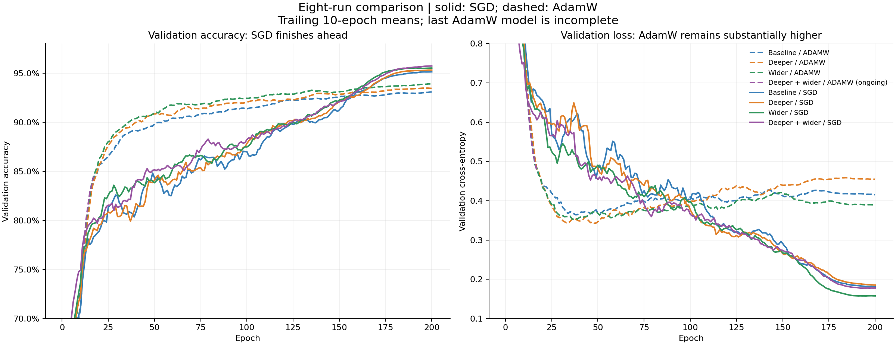

# Model comparison and next experiments

## Measured results

| Architecture | Optimizer | Parameters | Epochs | Selected epoch | Training loss | Validation loss | Validation accuracy | Epoch time total (h) |
|---|---|---:|---:|---:|---:|---:|---:|---:|
| Baseline | SGD | 1,084,586 | 200/200 | 194 | 0.00320 | 0.1824 | 95.26% | 1.58 |
| Baseline | ADAMW | 1,084,586 | 200/200 | 199 | 0.00046 | 0.4123 | 93.24% | 1.48 |
| Deeper | SGD | 1,860,522 | 200/200 | 199 | 0.00187 | 0.1826 | 95.38% | 2.08 |
| Deeper | ADAMW | 1,860,522 | 200/200 | 191 | 0.00049 | 0.4550 | 93.56% | 2.03 |
| Wider | SGD | 2,436,346 | 200/200 | 200 | 0.00219 | 0.1574 | 95.64% | 2.63 |
| Wider | ADAMW | 2,436,346 | 200/200 | 198 | 0.00023 | 0.3893 | 94.10% | 2.74 |
| Deeper + wider | SGD | 4,180,858 | 200/200 | 195 | 0.00157 | 0.1761 | 95.82% | 4.11 |
| Deeper + wider | ADAMW | 4,180,858 | 17/200 | 15 | 0.27029 | 0.3542 | 88.56% | 0.57 |

Epoch times are the sum logged inside training epochs, not total wall time. The final AdamW trial is incomplete. Every completed trial used the same split, 200 epochs, crop/flip augmentation, and zero mixup, RandAugment, erasing, dropout, or label smoothing.



## Findings

- More capacity helped SGD only modestly: 95.26% to 95.82%, +0.56 percentage points. Width contributed more than depth in these runs.
- The 2.44M wider SGD model achieved 95.64% with validation loss 0.1574; the 4.18M deeper+wider model achieved 95.82% with loss 0.1761. Their logged epoch totals are about 2.63 and 4.11 hours. The smaller model is a reasonable base for faster training-recipe experiments.
- Each completed AdamW trial underperformed matched SGD. AdamW drove training loss lower but produced validation losses around 0.39–0.45. This supports investigating generalization and confidence, rather than minimizing training loss further. It does not establish that AdamW cannot work with different tuning.
- Public accuracy progressed from 79.5% to 84.0% to 85.3%. Current best local accuracy is 95.82%: a 10.52-point difference. The cause is unconfirmed; an evaluation distribution mismatch, validation representativeness, and protocol differences remain hypotheses. Do not infer hidden labels or identify evaluation images from external sources.
- The latest submission CSV has 2,000 unique IDs, exact sample-submission order, and valid labels. Both inference and validation use RGB conversion, the same normalization, eval mode, and no validation augmentation. Code inspection found no obvious mismatch here.
- Training-only exact-pixel audit found zero duplicate groups and zero overlapping train/validation IDs. This excludes these particular leakage mechanisms, not every possible data issue. See train_split_audit.json.

## Prioritized changes

1. Validate horizontal-flip probability averaging on the existing validation split before deciding whether to use the already-supported --tta prediction option. Inspect per-class errors, confidence, and agreement between the two strongest SGD models. This needs validation-only inference, not another training sweep.
2. Run configs/generalization_plan.yaml: two fixed 2.44M wider-SGD trials. The first adds RandAugment with two operations and magnitude 7; the second adds mixup alpha 0.2 on top. Preserve optimizer, split, seed, and 200-epoch budget. These are starting settings, not demonstrated optima. Existing crop/flip-only wider SGD is their reference.
3. Select on validation accuracy, also inspecting cross-entropy and per-class behavior. Stronger augmentation/mixup can increase training loss; do not treat that alone as regression. Confirm the winning recipe with another training seed before paying for more capacity.
4. If augmentation improves generalization, test the recipe on the existing 4.18M model. If it does not, inspect failure modes before stacking dropout, smoothing, and erasing together.
5. If further changes are needed, consider SAM with SGD as a separate experiment. It requires a correct two-pass implementation and handling BatchNorm statistics; it is not currently supported by this engine and costs additional work per update. Pre-activation residual blocks are a later architecture candidate, not the first remedy for the observed gap.
6. After selecting the recipe and epoch budget locally, retrain from scratch on all 50,000 permitted training rows with data.val_fraction=0.0 and submit last.pt. This adds the held-out 5,000 training examples; do not use hidden evaluation images or labels for training or recipe selection.

## Prepared command

Run after the active plan stops or completes; do not start another GPU training process simultaneously.

```bash
source .venv/bin/activate
python -m cifar10 plan --config configs/generalization_plan.yaml --dry-run
python -m cifar10 plan --config configs/generalization_plan.yaml
```

The two configs were validated and their 2,436,346-parameter counts checked. They have not been trained or queued. The active eight-run plan was not modified.

## Evidence and limits

RandAugment and mixup have published generalization results, but none predicts a specific gain for this competition. Reaching 90% from 85.3% requires +4.7 percentage points, about a 32% reduction in error rate. There is no measured basis for promising that result from the proposed changes.

- [RandAugment](https://arxiv.org/abs/1909.13719)
- [mixup](https://arxiv.org/abs/1710.09412)
- [SAM](https://arxiv.org/abs/2010.01412)
